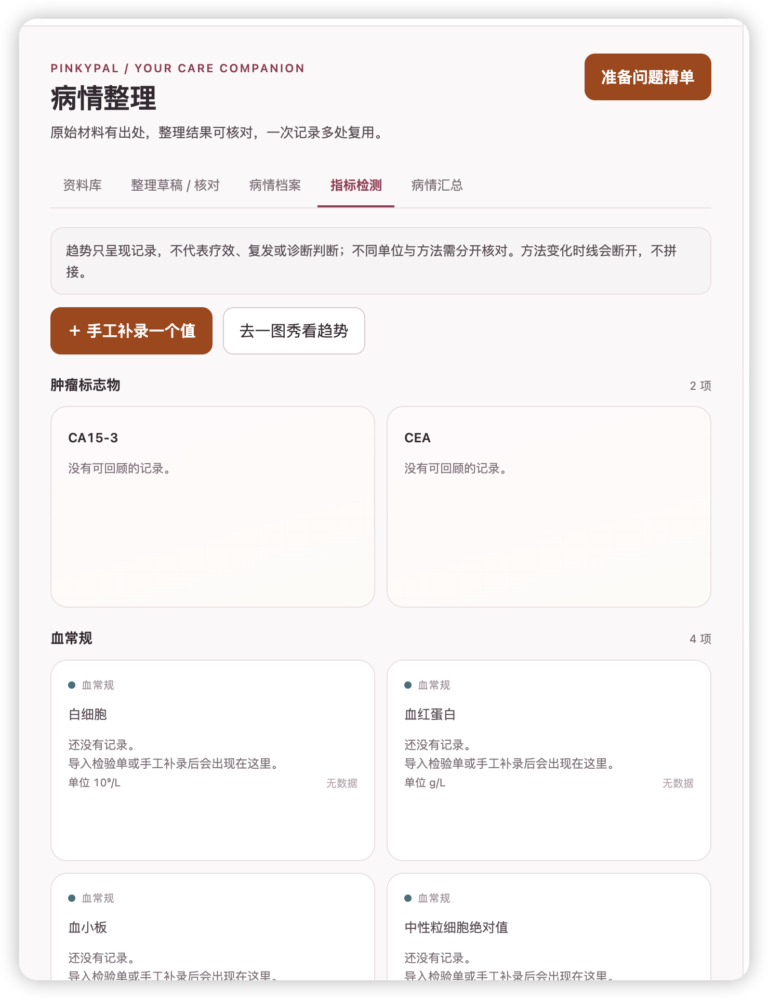
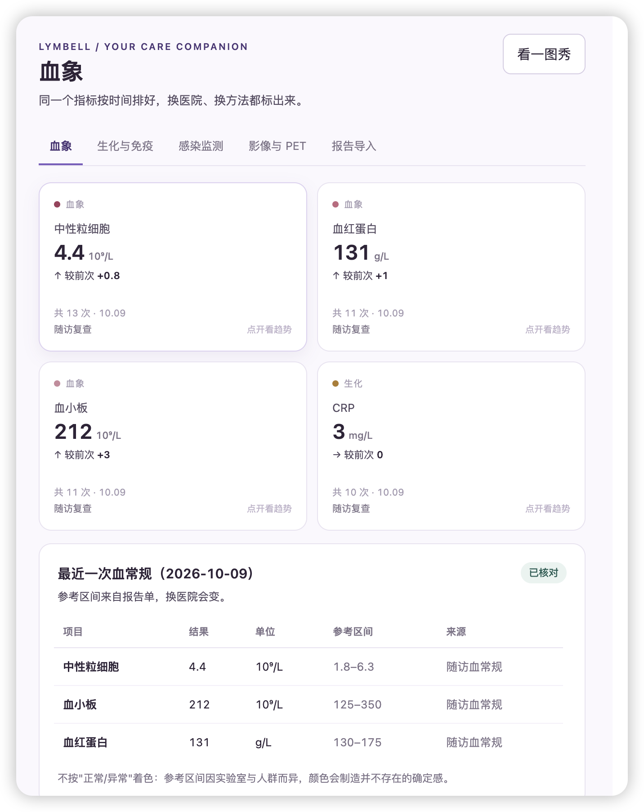

# 指标趋势 Tab · 分类展示与 3D 卡片设计规范

版本：1.0，2026-10-20。来源：开发者提供的乳腺癌“病情整理 / 指标检测”截图，以及淋巴瘤“血象”截图。本规范提取导航与卡片结构；每个项目使用自己的品牌、指标目录和真实记录，不复制另一癌种的检查清单、阈值或数据。

## 2026-10-20 · 开发者明确的核心交互

**按指标类型自动分类 → 每个指标的可比序列生成一张3D卡片 → 序列内部按采样时间从早到晚排列。**

- 分类取指标定义/别名映射，不要求患者手工分组，也不按每个日期另建一张卡。无法识别的项目保留在“其他已记录指标”，等待核对归类。
- 正面给最新已核对值、单位、日期、同组前次变化、记录次数与来源；背面是这项指标按真实时间轴排列的历次数据点和趋势。
- 点击整卡以`rotateY(180deg)`左右3D翻面，再点返回；卡高固定、每卡独立。来源点有独立点击行为，不能触发翻回。
- 类别之间分区，组内同一可比序列按时间排序；换单位/方法/机构拆可比组，不能为了时间连续而强行连线。
- 这是开发者对展示规则的明确确认；不自动等同于v4.2.7整版HTML或生产发布的验收通过。

## 1. 用户任务与页面层级

用户从报告或已有档案进入，找到某一类指标，看到最近的已核对记录；需要时翻面看变化，点数据点回原件，最后带着选择的材料准备复诊问题。

| 层级 | 页面/区域 | 作用 |
| --- | --- | --- |
| 工作台一级导航 | 病情整理 | 与看板、一图秀、治疗、照护等并列；不把每种化验拆成全局菜单 |
| 病情整理页头 | 标题、简短说明、右侧“准备问题清单” | 主说明：原始材料有出处，整理结果可核对，一次记录多处复用 |
| 页内一级 Tab | 资料库 / 整理草稿·核对 / 病情档案 / 指标检测 / 病情汇总 | 采用乳腺癌截图的信息架构；当前 Tab 用下划线与字重标识 |
| 指标检测页内分类 | 按类别逐组显示 | 采用淋巴瘤截图“分类标题→卡片组→最近报告”的阅读顺序 |
| 指标卡片 | 某一指标的可比序列 | 正面最近值，背面该序列的独立趋势 |
| 来源详情 | 原始数值、日期、单位、方法、机构、报告引用 | 能定位到报告页/字段，不把 AI 整理当医学结论 |

旧导航迁移必须给映射：如肺癌“诊断与分期”“取材与检测”收在“病情档案”的独立区块，保留穿刺、标本流转、病理、分子/PD-L1 全部内容与深链接；不能为了凑五个 Tab 删掉癌种特有功能。档案管理负责原件/输出文件，资料库负责关联与浏览，两者共享文件实体。

## 2. 版式与分类规则




- 顶部一条弱化的读图说明，然后是“手工补录一个值 / 导入检验单 / 去一图秀看趋势”。不在每组重复整套按钮。
- 已有记录的卡片优先展开；同组未记录项目收在“展开其余N项未记录指标”，目录项数仍完整。整组无数据时可先展示两张空卡，其余折叠，避免一屏空卡；展开后的目录顺序仍来自同一配置。
- 每一类自成一个区块：**类别名 + 指标项数 + 有记录项数**，下面两列等宽卡片；有数据的组默认展开，无数据的次要组可折叠。空组不可直接消失，折叠标题仍能找到。
- 卡片网格在可用内容宽度≥700px时两列，小于700px时一列；阈值以业务容器为准，不能只看整个显示器。每列 `minmax(0,1fr)`。不做三列以上密集墙。
- 类别的标题、顺序、项目归属由唯一 `metricCatalog/categoryOrder` 给出。指标页与一图秀选择目录共用；同一病例/筛选口径下两页组名、顺序、目录项数一致。
- 一项有多个可比组时，标题计数区分“指标项”和“可比组”，如“4项 · 5个可比组”；不得把同名不同方法的记录覆盖为一个值。
- 肺癌适配示例：肿瘤标志物；血常规；肝功能；肾功能与电解质；炎症与感染相关；营养相关；身体测量。目录用于整理已有记录，不代表推荐逐项检查。
- 肿瘤标志物可配置 CEA、CYFRA21-1、NSE、SCC、ProGRP；其他癌种按自身目录适配，不把肺癌项目复制为通用必查项。
- 颜色只标类别/系列身份，不用红绿或颜色深浅暗示正常、异常、好转、恶化。与已审定的分级功能并存时，分级是单独、有来源的派生对照，不能把趋势箭头当分级。

## 3. 正面信息层级

| 从上到下 | 必须呈现 | 缺失时 |
| --- | --- | --- |
| 类别眉题 | 小圆点 + 类别名 | 目录未映射时进入“其他已记录指标”，可修正归类 |
| 指标名 | 完整名称，必要时全名换行 | 不用仅缩写代替来源名称 |
| 最近值 | 大号数值 + 原报告单位 | 无记录写“还没有记录”，不能显示0；数值0是有效记录 |
| 与前次比较 | ↑/↓/→、差值；差值来自同一可比组 | 单点写“暂无可比较的前次记录”；可比信息不齐写“仅显示记录点” |
| 数据覆盖 | 已核对记录次数 + 最近采样日期 | 日期未知不冒充最近一次；另显示“日期待核N条” |
| 来源与交互提示 | 报告/检测机构摘要、点开看趋势 | 真实原件缺失时写“来源待补”，不能生成假报告链接 |

“较前次”必须指同一指标/单位/方法/机构的前一次有效记录，不是全体记录的倒数第二条；显示比较两日期，不能从变动方向推断疗效。计数默认只算当前病例的已核对、未撤回记录；候选数单独列在核对入口。

同日多条：若有采样时刻/报告修订号就按原始版本顺序；无法确定先后时并列显示“同日多次”，不擅定最新，不算前次差值。同一时间戳不同来源不静默去重。

## 4. 背面：趋势与来源

1. 顶部固定指标名与单位。中间独立 SVG 折线图；底部方法、机构、可比性与交互提示。背面不能变成一段长解释取代图表。
2. 横轴真实采样日期；间隔按时间比例，不能按点序号等距。纵轴只属于该指标/可比组。
3. 单点只画点；零条给空态；缺值不补0；未知日期不定位到日期轴。轻度单调平滑经过原始点，控制点不超出相邻端点，不外推，不预测。
4. 换单位、方法或检测机构：优先拆可比组和卡片；不连接跨组折线，不自行换算。方法/机构未知时仍保留数值与来源，只画点、不算差值。
5. 每个测量点有可点击命中区，点击/Enter/Space打开来源详情；必须阻止冒泡，不能顺便把整卡翻回正面。
6. 来源详情给原报告引用、采样日/报告日、转录原文、参考区间原文、核对状态；有真实原件时打开原件，无原件时如实说明。关闭后回到原卡/原点焦点。
7. 每类下方可放“最近一次报告”表：项目 / 结果 / 单位 / 参考区间原文 / 来源。按同一报告ID和修订版聚合，不能把不同报告各自的最新值拼成一张“最近化验单”。

## 5. 3D 翻面合同（不是展开）

- 外卡固定高度276px，圆角18px，内边距20px，卡间距16px；宽度随网格变化。数字约33px、项目名15px、正文12px、元信息11px。项目大字模式可统一升至预先约定的340px等高度，正反面必须一致，不随内容撑开。
- **点击整卡一次转180°显示趋势，再次点击返回最近值**；每卡独立状态。选择筛选、翻其他卡、重播动画不能重置已有翻面状态。切换病例重置或以病例ID隔离。
- 不增加“查看趋势 / 返回正面”的大按钮；正面用弱提示。数据点、来源链接、复选框等子控件有自己的动作，不能触发整卡翻转。
- `perspective:1100px` 放外卡，`transform-style:preserve-3d` 放内层；两面绝对定位 `inset:0`，双面 `backface-visibility:hidden`，背面预转180°。
- 480ms `cubic-bezier(.2,.7,.2,1)`；只按明确点击翻转，不在hover、滚动、加载时自动翻。hover只做克制边框/阴影。
- 零条卡可翻到空态说明，但仍无折线；固定高度不能为一行空提示留出多余大区域。长来源换行/截断后在详情读全，不把卡片撑高。

```css
.metric-card { position:relative; height:276px; perspective:1100px; min-width:0; }
.metric-card-inner { position:relative; height:100%; transform-style:preserve-3d;
  transition:transform 480ms cubic-bezier(.2,.7,.2,1); }
.metric-card[data-flipped=true] .metric-card-inner { transform:rotateY(180deg); }
.metric-face { position:absolute; inset:0; padding:20px; border-radius:18px;
  backface-visibility:hidden; -webkit-backface-visibility:hidden; }
.metric-back { transform:rotateY(180deg); }
@media(prefers-reduced-motion:reduce) { .metric-card-inner { transition:none; } }
```

卡片使用 `role=group`、`tabindex=0`、明确 `aria-roledescription/aria-label`，不要把包含来源按钮的整卡做成嵌套按钮。仅卡片本身获得焦点时 Enter/Space 翻面；数据点自行处理。隐藏面设置 `aria-hidden` + `inert`，不可有隐藏焦点。变换改变视觉，不能只隐藏文字而让两面都在读屏顺序里。系统与应用的减少动效均直接切终态。

## 6. 观察记录与读模型合同

数据实体不跟随Tab另建重复库。建议字段，按项目已有schema映射：

| 实体 | 字段 |
| --- | --- |
| 指标定义 | metricId / displayName / aliases / categoryId / displayOrder / expectedUnits（目录提示，不覆盖原单位） |
| 原始观察 | observationId / caseId / metricId / rawValue / numericValue / rawUnit / sampleDate+precision / reportDate / method / laboratory / specimenId / referenceRangeText |
| 来源与版本 | documentId / documentRevision / pageOrFieldAnchor / sourceText / reviewState / recordRevision / supersedesId |
| 可比序列读模型 | identity=(caseId,metricId,unit,method,laboratory) / confirmedRows / undatedCount / latest / previousComparable / delta / connectable |
| 卡片视图状态 | caseId+seriesIdentity → flipped；无患者值的显示偏好可持久化，不能把病例内容写入偏好存储 |

姓名、手工录入、上传解析、历史报告均进入同一来源链：选择/上传原件→解析候选→逐条核对→事务保存SQLite→指标页/一图秀读同一记录。解析成功不等于已确认。导出来自已确认记录与原件索引，不另建前端私有“趋势事实”。

未知日期、文本结果（如“<0.1”“未检出”）、非法数值必须保留原文；没有明确可绘数值时不强转为0或任意阈值。报告参考区间缺失显示“未转录”，不填通用正常值。本规范不新增临床分级阈值，已有分级按项目另行审核的标准来源合同执行。

## 7. 必须覆盖的状态

| 状态 | 卡片/图表行为 |
| --- | --- |
| 空病例/零条 | 按目录分类，类别和项数可见；无数值、无假曲线，导入/补录可到达 |
| 单点 | 正面数值，背面点和日期，无折线，无前次差值 |
| 多点 | 同组差值与轻度平滑；保留所有原点 |
| 单位/方法/机构变化 | 拆序列，不跨接；卡片标出所属方法/机构，组内项数与可比组数分开 |
| 日期/方法未知 | 日期未知不入轴；方法未知只画有效日期的点 |
| 非数值/检出限 | 原文可读，不能用近似阈值做趋势或差值 |
| 候选/被撤回/旧修订 | 不进入正式计数与曲线；核对入口可回查 |
| 同日多次/跨院报告 | 保留来源、时刻和修订；顺序不明时不假定“前次” |
| 许多指标/许多事件 | 指标按类别组织，次要空组折叠；趋势高度不由事件条数撑高；详见一图秀规范 |
| 大字/窄窗/减少动效 | 单列、固定双面高度、字体不重叠、隐藏面不可聚焦、直接终态切换 |

## 8. 实施步骤与验收

先填项目 `docs/METRIC-TREND-SPEC.md`，把导航映射、目录、schema和空态选定；交付可打开的HTML，逐项自检与开发者确认后实施生产组件。截图不是确认；不要因文档已沉淀就把SQLite/宿主能力标成接通。

| ID | 可操作验收 |
| --- | --- |
| MT01 | 从全局“病情整理”进入“指标检测”，五个页内Tab与旧深链接映射可走通 |
| MT02 | 肿瘤标志物、血常规等独立标题和网格，不混在一个平铺容器 |
| MT03 | 指标页与一图秀同一目录，组名、顺序和项数一致 |
| MT04 | 正面完整显示类别/名/值/单位/日期/次数/来源；差值不写疗效结论 |
| MT05 | 单点、0值、空态、文本值、未知日期分别显示正确 |
| MT06 | 方法、单位、机构变化不跨组连线或做差；同日无顺序不做“前次” |
| MT07 | 点击两次恢复正面，其他卡和页面高度不变，无上下叠加 |
| MT08 | 鼠标与键盘都可翻面，隐藏面不进入Tab序，减少动效没有旋转过程 |
| MT09 | 点图点打开原始来源，整卡不翻回；关闭详情焦点恢复 |
| MT10 | 候选核对前不入图，核对后SQLite重开仍存在，两页读同一值 |
| MT11 | 最近报告表来自同一报告ID/修订，未知区间明确留空 |
| MT12 | 700px/620px/窄内容区、大字下无整页横向溢出，二列→一列合理 |
| MT13 | 病例切换隔离翻面/筛选/草稿，不串患者信息 |
| MT14 | 100+记录、500事件压力数据下，曲线仍在固定区域；原始事件可逐项回查 |
| MT15 | HTML版本/hash、截图、偏差、确认范围和真实Desktop验收状态已分别记录 |

## 9. 参考资料与复用边界

- 乳腺癌截图：借鉴病情整理五Tab与分类区块；淋巴瘤截图：借鉴类别眉题、最近值/差值/次数/来源、最近报告表。
- 本文件新增明确的3D实现与来源/可比性合同；图片只是视觉参考，不能推导出真实数据管道或医学阈值已实现。
- 病例数据、品牌、调色、可比性政策和参考标准由项目填写；不硬编码另一个项目路径或任何有效凭据。


2026-10-20菜单精简：一图秀的指标选项仅显示简称（如CEA、CA19-9、NSE、WBC），按可用空间紧凑排列。单位、方法、机构放悬停提示/可访问名称/详情，不占菜单正文。简称来自共享目录/别名映射；完整可比组标识保持不变，同名不同方法仍分组。示例简称不等于自动增加该癌种的检查项目。


2026-10-20生产落地反馈：用户指定应用中的旧时间记录列表时，应直接替换生产指标Tab并安装到正确Desktop profile，不能只更新原型/文档后声称完成。共用类型目录需覆盖凝血、感染与炎症等，歧义缩写归其他待核，不猜类型。空类别折叠但入口可找；时间历史可放卡片背面独立滚动，固定卡高内图表使用剩余空间，禁止与列表重叠。未指定整页导航改动时，逐模块记录实施范围。
